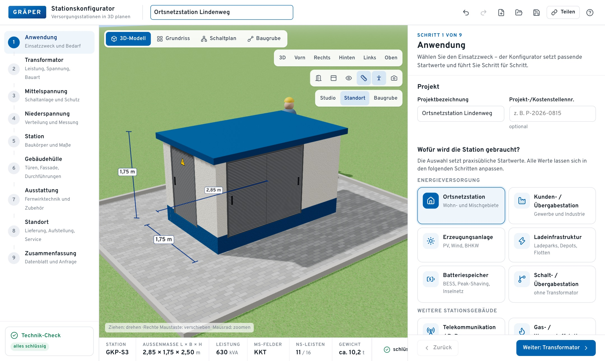
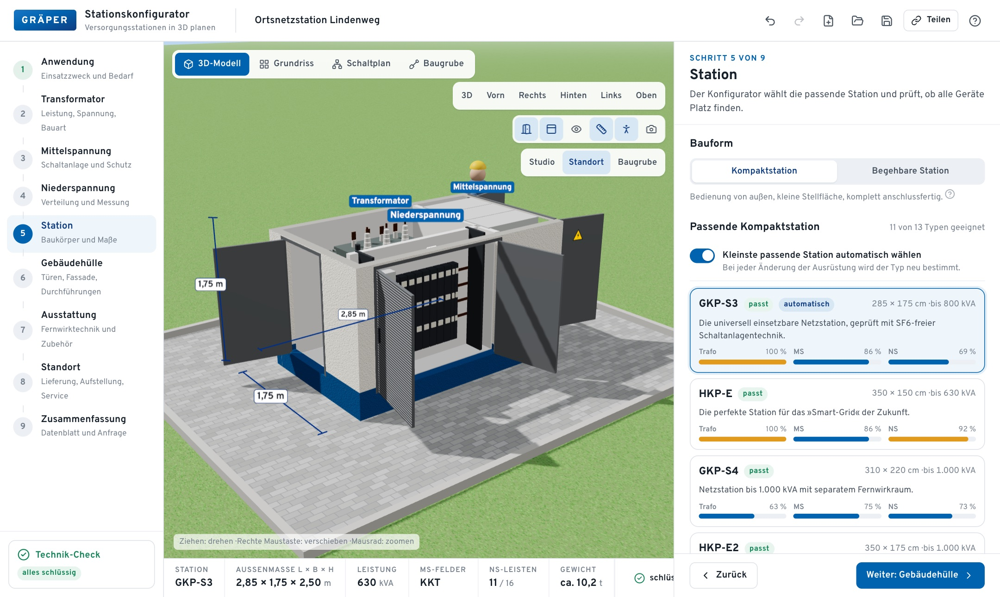
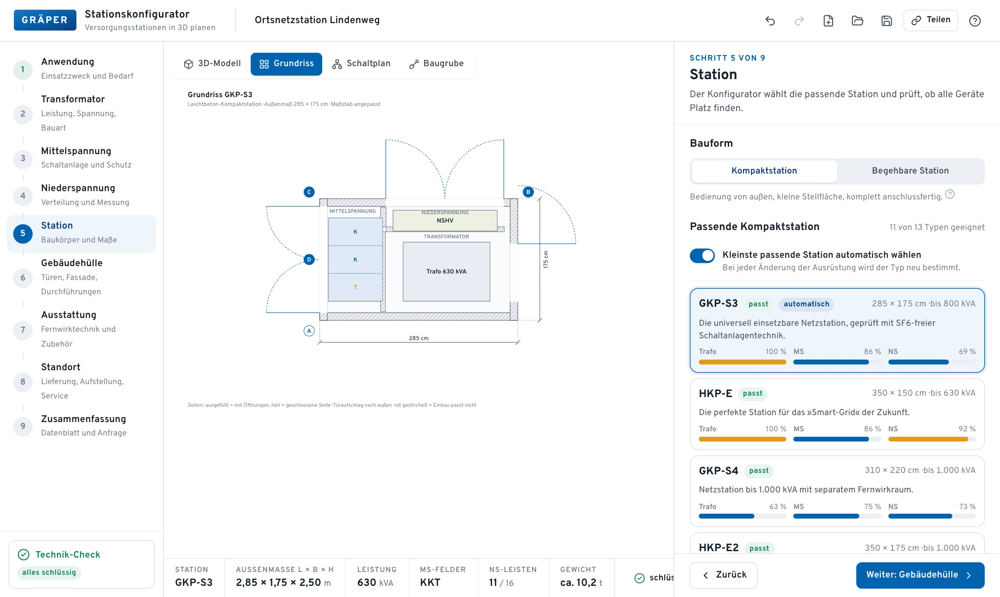
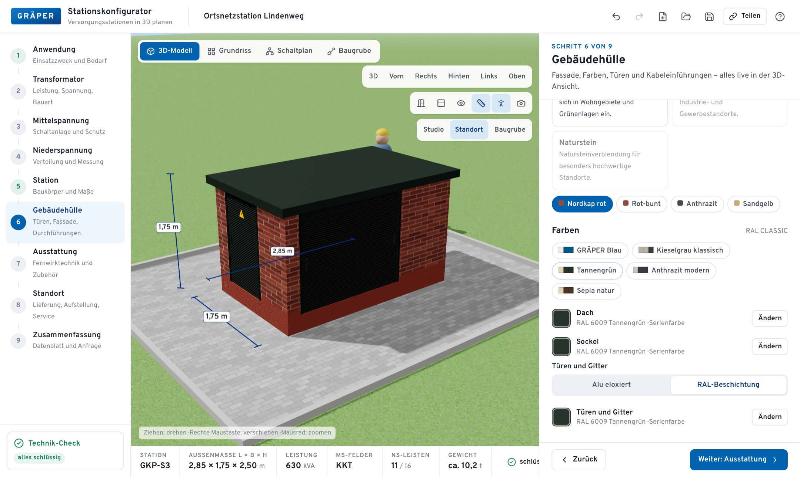
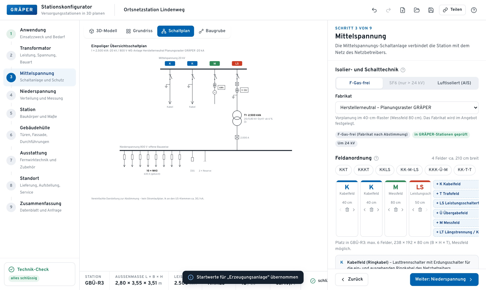
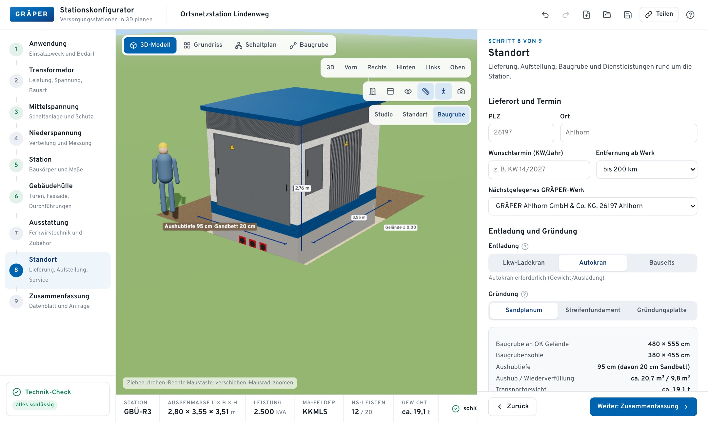
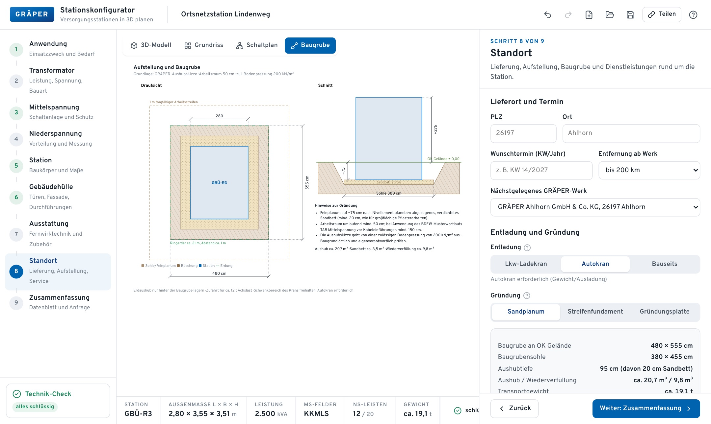
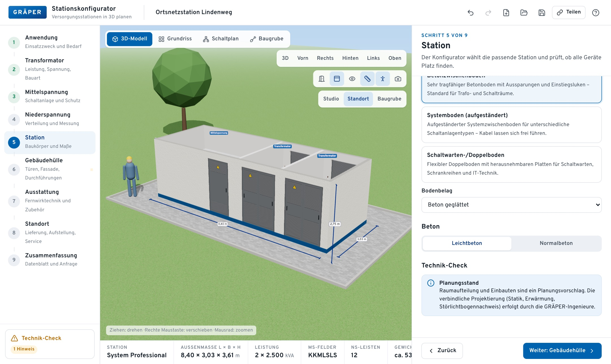
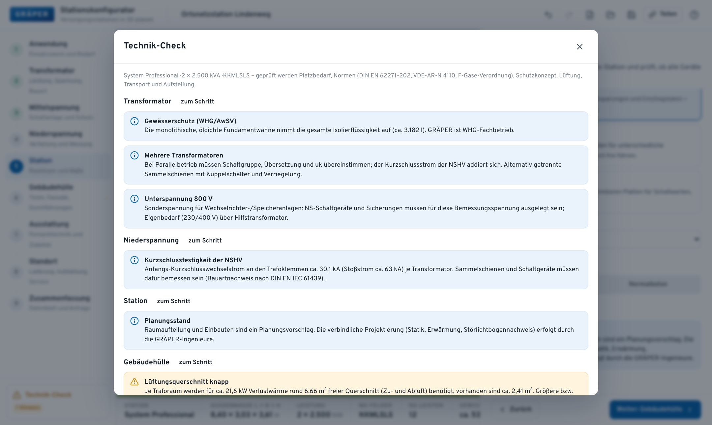
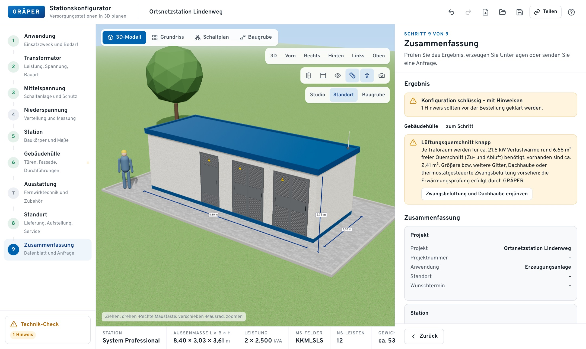

<div align="center">

# GRÄPER 3D-Stationskonfigurator

**Versorgungsstationen in 3D planen – von der Ortsnetzstation bis zum Trafostand**

Geführter Online-Konfigurator für Kompaktstationen, begehbare Stationen und Trafostände der GRÄPER-Gruppe
mit Echtzeit-3D-Modell, Technik-Check, 2D-Plänen und Anfrage an den Vertrieb.




</div>

---

## Inhalt

- [Worum es geht](#worum-es-geht)
- [Funktionen im Überblick](#funktionen-im-überblick)
- [Rundgang in Bildern](#rundgang-in-bildern)
- [Schnellstart](#schnellstart)
- [Betrieb auf einem Server](#betrieb-auf-einem-server)
- [Projektaufbau](#projektaufbau)
- [Fachliche Grundlagen und Datenstand](#fachliche-grundlagen-und-datenstand)
- [Grenzen und nächste Schritte](#grenzen-und-nächste-schritte)

---

## Worum es geht

Eine Transformatorstation wandelt Strom aus dem Mittelspannungsnetz (meist 20 kV) in die Niederspannung (400 V) um,
die Haushalte, Gewerbe, Ladeparks oder Batteriespeicher nutzen. Wer eine solche Station plant, muss viele Dinge
aufeinander abstimmen: Transformatorleistung, Schaltanlage, Niederspannungsverteilung, Baukörper, Fassade, Zugang,
Transport und Baugrube.

Der Konfigurator führt durch genau diese Entscheidungen. Er wählt automatisch den passenden GRÄPER-Stationstyp,
prüft die Konfiguration gegen Normen und Praxisregeln und zeigt das Ergebnis sofort als 3D-Modell.
Am Ende stehen ein Datenblatt, eine Leistungsbeschreibung, eine Stückliste und auf Wunsch eine Anfrage an GRÄPER.

**Zielgruppen:** Netzbetreiber und Stadtwerke, Industrie und Gewerbe, Planungsbüros, Projektierer von PV-, Wind-,
Speicher- und Ladeprojekten sowie der GRÄPER-Vertrieb selbst. Fachbegriffe werden über ein Glossar in einfacher Sprache erklärt.

---

## Funktionen im Überblick

| Bereich | Was der Konfigurator kann |
|---|---|
| **Anwendungsfälle** | Zehn Einstiege mit praxisüblichen Startwerten: Ortsnetzstation, Kunden-/Übergabestation, Erzeugungsanlage, Ladeinfrastruktur, Batteriespeicher, Schaltstation, Telekommunikation/PoP, Gas-/Wasserstoffstation, Pump-/Wasserstation, Trafostand |
| **Bedarfsrechner** | Schätzt die Transformatorleistung aus Haushalten, Wärmepumpen, Wallboxen, Ladepunkten, Gewerbelast, PV- oder Speicherleistung |
| **Transformator** | Leistung 100–3.150 kVA, Öl, Ester oder Gießharz, 10/20/30 kV, 400/690/800 V, uk, Schaltgruppe, rONT, Kennwerte nach Ökodesign Stufe 2 |
| **Mittelspannung** | F-Gas-freie Schaltanlagen mehrerer Fabrikate, Feldeditor (Kabel-, Trafo-, Leistungsschalter-, Übergabe-, Mess-, Kupplungsfeld), Schutzkonzept HH, UMZ, Q-U |
| **Niederspannung** | Offene oder gekapselte Bauweise, NH00–NH3-Abgänge, Leistungsschalter-Abgänge, Verrechnungsmessung, Straßenbeleuchtung, Baustrom, Kompensation |
| **Stationswahl** | Automatische Auswahl der kleinsten passenden von 13 Kompaktstationen mit Auslastungsanzeige; begehbare Stationen als System Serie, Professional (30-cm-Raster) oder Individual |
| **Gebäudehülle** | Reibe-/Rollputz, Waschbeton, Klinker, Holz, Metall, Naturstein; alle RAL-Farben; Türen, Lüftungsgitter, Einbruchschutz RC2/RC3, Brandschutz, Kabeldurchführungen |
| **Ausstattung** | Fernwirktechnik, Kommunikation, Hilfsspannung, Stationsmonitoring EniMonTS, § 14a EnWG, Zubehör |
| **Standort** | Entladung, Gründung, Baugrube nach GRÄPER-Aushubskizze, Transportbreite und -gewicht, Baustellen-Checkliste, Dienstleistungen |
| **Technik-Check** | Über 50 Regeln mit verständlichen Hinweisen und Korrektur per Klick |
| **Ansichten** | 3D-Modell (Türen öffnen, Dach ausblenden, Röntgenblick, Maße, Größenvergleich, Studio/Standort/Baugrube), Grundriss, Übersichtsschaltplan, Baugrubenplan |
| **Ergebnis** | Datenblatt (Druck/PDF), Leistungsbeschreibung, Stückliste (CSV), Konfiguration (JSON), Teilen-Link, Anfrageformular |
| **Komfort** | Automatisches Speichern im Browser, gespeicherte Varianten, Rückgängig/Wiederholen, Glossar mit 47 Begriffen |

---

## Rundgang in Bildern

### 1. Station wählen und ins Innere schauen

Der Konfigurator zeigt, welche Kompaktstationen zur gewählten Technik passen und wie stark Transformatorraum,
Schaltanlagenraum und Niederspannung ausgelastet sind. Im 3D-Modell lassen sich Türen öffnen und das Dach ausblenden.



### 2. Grundriss mit Maßen

Der Grundriss zeigt Wände, Räume, Türaufschläge und die Lage von Transformator, Schaltanlage und Verteilung.
Seiten mit Türen sind farbig markiert, geschlossene Seiten (wichtig bei Grenzbebauung) hell.



### 3. Fassade und Farben

Oberflächen und RAL-Farben werden sofort im Modell sichtbar. Fertige Farbkombinationen helfen bei der schnellen Auswahl.



### 4. Übersichtsschaltplan

Aus den gewählten Feldern, Transformatoren und Abgängen entsteht automatisch ein einpoliger Übersichtsschaltplan zur Abstimmung.



### 5. Baugrube und Aufstellung

Die Baugrube wird nach den GRÄPER-Aushubskizzen berechnet und in 3D sowie als bemaßter Plan mit Schnitt dargestellt.

| Baugrube in 3D | Baugrubenplan |
|---|---|
|  |  |

### 6. Begehbare Stationen

Reicht eine Kompaktstation nicht aus, etwa bei zwei Transformatoren, plant der Konfigurator eine begehbare Station
im GRÄPER-Raster mit eigenem Raum je Transformator.



### 7. Technik-Check und Zusammenfassung

Der Technik-Check sammelt alle Hinweise nach Schritten. Die Zusammenfassung bündelt Ergebnis, Stückliste, Unterlagen und Anfrage.

| Technik-Check | Zusammenfassung |
|---|---|
|  |  |

---

## Schnellstart

**Voraussetzung:** [Node.js](https://nodejs.org) ab Version 22.13 (wegen der eingebauten SQLite-Datenbank). Weitere Software ist nicht nötig.

1. Repository holen und in den Ordner wechseln:

```bash
git clone https://github.com/victus17/GRAEPER-3D-Konfigurator.git
```

```bash
cd GRAEPER-3D-Konfigurator
```

2. Abhängigkeiten installieren:

```bash
npm install
```

3. Oberfläche bauen:

```bash
npm run build
```

4. Server starten:

```bash
npm start
```

Der Konfigurator ist dann unter **http://localhost:8787** erreichbar. Beenden mit `Strg+C`.

### Für die Entwicklung

Mit Live-Neuladen bei Codeänderungen auf Port 5173 (API-Aufrufe gehen an den Server auf Port 8787):

```bash
npm run dev:all
```

| Befehl | Zweck |
|---|---|
| `npm run dev` | Nur Oberfläche mit Live-Neuladen (Port 5173) |
| `npm run server` | Nur Server (Port 8787) |
| `npm run dev:all` | Beides zusammen |
| `npm run build` | Typprüfung und Produktions-Build nach `dist/` |
| `npm start` | Server mit gebauter Oberfläche |
| `npm run typecheck` | Nur Typprüfung |
| `npm test` | Tests der Fachlogik |

---

## Betrieb auf einem Server

Der Server ist ein schlanker [Fastify](https://fastify.dev)-Dienst. Er liefert die gebaute Oberfläche aus und speichert
geteilte Konfigurationen und Anfragen in einer SQLite-Datei. Der Konfigurator funktioniert auch ohne Server:
Teilen-Links werden dann komprimiert im Link selbst gespeichert, Anfragen öffnen einen E-Mail-Entwurf.

### Umgebungsvariablen

| Variable | Bedeutung | Standard |
|---|---|---|
| `PORT` | Port des Servers | `8787` |
| `HOST` | Adresse, an die der Server bindet (für Netzbetrieb `0.0.0.0`) | `127.0.0.1` |
| `DATA_DIR` | Ordner für Datenbank und Anfrage-Ablage | `./data` |
| `ADMIN_TOKEN` | Zugangsschlüssel für die Admin-Schnittstelle; leer bedeutet gesperrt | leer |
| `INQUIRY_WEBHOOK_URL` | Webhook, der bei jeder neuen Anfrage aufgerufen wird (z. B. CRM oder Teams) | leer |
| `LOG_LEVEL` | Protokollstufe | `info` |

Beispiel für den Betrieb im Firmennetz:

```bash
HOST=0.0.0.0 PORT=8080 ADMIN_TOKEN=bitte-geheimen-wert-setzen npm start
```

### Schnittstellen

| Methode | Pfad | Zweck |
|---|---|---|
| `GET` | `/api/health` | Statusprüfung |
| `POST` | `/api/configurations` | Konfiguration speichern, liefert Kennung für den Teilen-Link |
| `GET` | `/api/configurations/:id` | Gespeicherte Konfiguration laden |
| `POST` | `/api/inquiries` | Anfrage absenden (Pflichtfelder und Einwilligung werden geprüft) |
| `GET` | `/api/admin/inquiries` | Anfragen auflisten (Header `x-admin-token`) |
| `GET` | `/api/admin/inquiries/:id` | Einzelne Anfrage mit vollständiger Konfiguration |
| `PATCH` | `/api/admin/inquiries/:id` | Status setzen: `neu`, `in Bearbeitung`, `angeboten`, `abgeschlossen` |

Jede Anfrage wird zusätzlich als JSON-Datei und als Leistungsbeschreibung in `data/outbox/` abgelegt.
Ein E-Mail-Versand ist bewusst nicht eingebaut; er wird über den Webhook oder den Ausgangsordner an die vorhandene IT angebunden.
Schreibzugriffe sind auf 30 pro Minute und Adresse begrenzt.

---

## Projektaufbau

```text
├── index.html              Einstiegsseite
├── public/                 Favicon
├── src/
│   ├── data/               Stammdaten: Stationskatalog, Elektrotechnik, Optionen, RAL-Farben, Glossar, Anwendungsfälle
│   ├── domain/             Fachlogik ohne Oberfläche: Berechnung, Geometrie, Stationswahl, Regelwerk, Leistungsbeschreibung
│   ├── state/              Zustandsverwaltung (zustand) mit Verlauf und Speicherung
│   ├── steps/              Die neun Konfigurationsschritte
│   ├── three/              3D-Modell mit three.js / React Three Fiber, alle Texturen per Code erzeugt
│   ├── views/              Grundriss, Schaltplan, Baugrubenplan, Druck-Datenblatt (SVG)
│   ├── ui/                 Bedienelemente
│   ├── lib/                Hilfsfunktionen (Format, Dateien, Teilen)
│   └── styles/             Designsystem in den GRÄPER-Farben
├── server/index.mjs        Fastify-Server mit SQLite
├── tests/                  Tests der Fachlogik (Vitest)
└── docs/
    ├── UEBERGABE.md        Arbeitsstand und offene Punkte
    ├── recherche/          Rechercheunterlagen (ungeprüft)
    └── screenshots/        Bilder für diese Beschreibung
```

**Wichtige Dateien für Anpassungen**

| Anpassung | Datei |
|---|---|
| Stationstypen, Maße, Grenzen, PDF-Links | `src/data/stations.ts` |
| Transformatordaten, Sicherungen, Schaltanlagen-Fabrikate | `src/data/electrical.ts` |
| Fassaden, Türen, Zubehör, Dienstleistungen | `src/data/options.ts` |
| Regeln des Technik-Checks und Korrekturen | `src/domain/engine.ts` |
| Erklärtexte des Glossars | `src/data/glossary.ts` |
| Farben und Layout | `src/styles/app.css` |

Die Oberfläche lädt keine externen Dateien: Schrift, Texturen und Symbole sind im Build enthalten. Damit läuft der Konfigurator auch in abgeschotteten Firmennetzen.

---

## Fachliche Grundlagen und Datenstand

**Quellen der Stationsdaten:** Website von GRÄPER, Broschüre „Produktportfolio Kompaktstationen" (Stand 08/2026),
Broschüre „Begehbare Stationen" (Stand 06/2026), Kundenzeichnungen, Hebepläne und Aushubskizzen der einzelnen Typen sowie
das Informationsblatt zur Stationsaufstellung. Die Links zu den Original-PDFs stehen in `src/data/stations.ts` und werden im Konfigurator angezeigt.

**Berücksichtigte Normen und Regeln (vereinfacht umgesetzt):**

- DIN EN 62271-202: fabrikfertige Stationen, Störlichtbogenklassifizierung IAC-AB 20 kA/1 s
- Verordnung (EU) 2024/573: Inbetriebnahmeverbot für F-Gas-Schaltanlagen bis 24 kV ab 2026
- Verordnung (EU) 2019/1783: Verlustgrenzwerte für Transformatoren (Ökodesign Stufe 2)
- VDE-AR-N 4110: Schutz und Messung an Kundenanlagen und Erzeugungsanlagen
- DIN VDE 0101-1: Mindestbreite von Bediengängen
- DIN EN IEC 61439: Niederspannungs-Schaltgerätekombinationen
- 26. BImSchV und TA Lärm: Felder und Schall in Wohngebieten
- WHG/AwSV: Auffangen der Isolierflüssigkeit

---

## Grenzen und nächste Schritte

Der Konfigurator ist ein Werkzeug für **Vorplanung, Beratung und Anfrage**, kein Ersatz für die technische Projektierung.

- Stationsdaten stammen belegt aus GRÄPER-Unterlagen.
- Abmessungen und Gewichte der Transformatoren, HH-Sicherungswerte und Feldbreiten der Schaltanlagen sind **Richtwerte** und vor einem produktiven Einsatz mit Hersteller- und GRÄPER-Daten abzugleichen.
- Raumaufteilung, Gewicht und Lüftung begehbarer Stationen beruhen auf Faustformeln.
- Das 3D-Modell ist schematisch, kein CAD-Modell; der Schaltplan ist eine Übersicht, kein Stromlaufplan.
- Preise und Lieferzeiten sind bewusst nicht enthalten.

Vorgeschlagene nächste Schritte stehen in [`docs/UEBERGABE.md`](docs/UEBERGABE.md): fachliche Freigabe durch GRÄPER-Ingenieure,
Ersatz der Richtwerte durch GRÄPER-Stammdaten, Abgleich mit realen Projekten, Anbindung an E-Mail/CRM, Originallogo,
CAD-Export und weitere Sprachen.

---

<div align="center">
<sub>Interne Entwicklung für die GRÄPER-Gruppe · Alle Rechte vorbehalten · Planungsstand ohne Gewähr – verbindlich sind Angebot und technische Klärung durch GRÄPER</sub>
</div>
